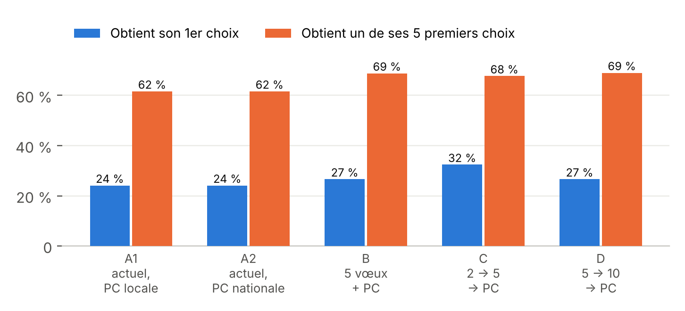
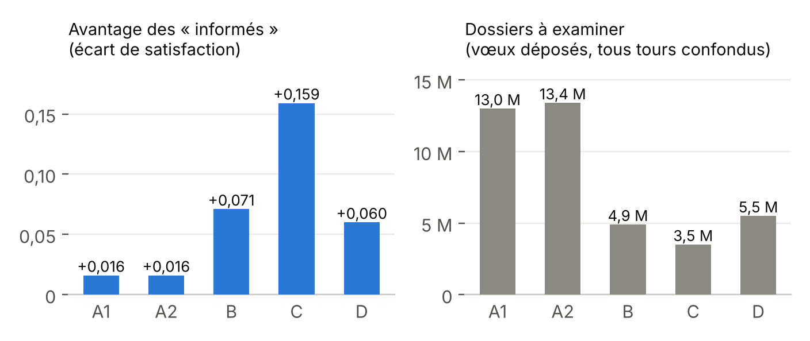
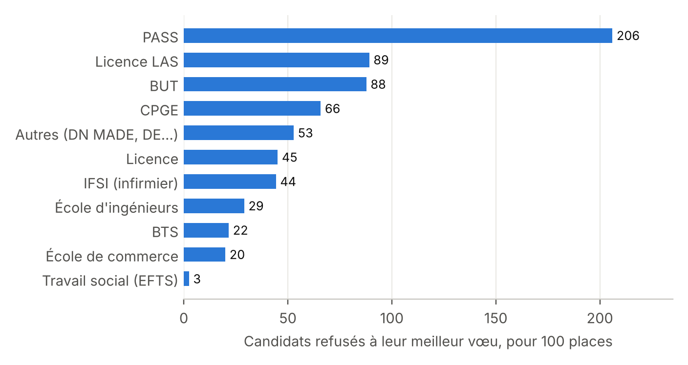
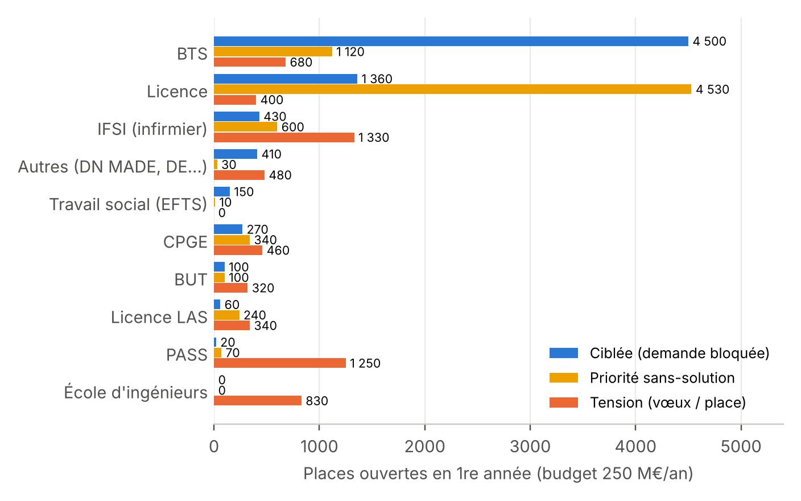
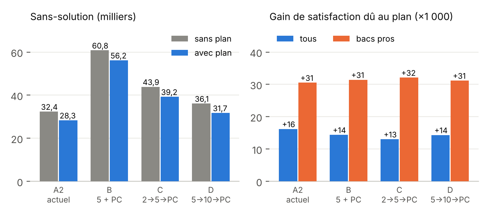

# Parcoursup : moins de vœux, de meilleurs choix ? Où ouvrir des places ?

**Un « jumeau numérique » de Parcoursup pour tester des réformes avant de les décider.**

Ce dépôt simule la procédure Parcoursup à partir des **données ouvertes officielles 2025** : les 14 248 formations réelles, leurs 769 351 places, et 930 000 candidats virtuels calés sur les résultats réels. On peut y changer les règles du jeu (nombre de vœux, nombre de tours, phase complémentaire, ouverture de places…) et mesurer qui y gagne, qui y perd, et à quel coût.

Auteur : **Johel Mitéran**, professeur des universités, Université Bourgogne Europe (laboratoire IMVIA). Simulation et rédaction réalisées avec l'assistance de Claude (Anthropic).

Les deux rapports complets sont dans [`docs/`](docs/) :
- [Parcoursup : moins de vœux, de meilleurs choix ?](docs/Parcoursup_variantes_de_reforme.pdf) : cinq variantes de règles ;
- [Parcoursup : où ouvrir des places ?](docs/Parcoursup_ouvrir_des_places.pdf) : où, combien et à quel prix ouvrir des places, plus le plan gouvernemental de 15 000 places.

> ⚠️ Ce sont des **résultats de simulation, pas des prévisions**. Les **écarts entre variantes** sont plus fiables que les valeurs absolues. Les hypothèses et les limites sont détaillées plus bas.

---

## Sommaire

1. [En deux minutes (pour tout le monde)](#1-en-deux-minutes-pour-tout-le-monde)
2. [Les résultats principaux](#2-les-résultats-principaux)
3. [Comment fonctionne la simulation](#3-comment-fonctionne-la-simulation)
4. [Installer et lancer](#4-installer-et-lancer)
5. [Faire varier les paramètres](#5-faire-varier-les-paramètres)
6. [Pour les spécialistes : modèle, calage, validation](#6-pour-les-spécialistes--modèle-calage-validation)
7. [Limites](#7-limites)
8. [Organisation du code](#8-organisation-du-code)
9. [Sources](#9-sources)

---

## 1. En deux minutes (pour tout le monde)

### Parcoursup aujourd'hui

- Environ **980 000 candidats** par an, dont 650 000 lycéens.
- Jusqu'à **10 vœux et 20 sous-vœux** (plus 10 en apprentissage) : en moyenne **14 vœux par lycéen**, **13 millions de vœux** au total.
- Deux temps : la **phase principale** (juin-juillet), puis la **phase complémentaire** sur les places restantes.

### La question

> *Et si on limitait le nombre de vœux, pour que chacun ne demande que ce qui compte vraiment ?*

Est-ce que ça augmenterait les chances d'avoir ce qu'on veut ? Est-ce que ça ferait plus de laissés-pour-compte ? Et si l'on ouvre des places, où faut-il les ouvrir ?

### Le mécanisme caché : l'effet d'éviction

> **Léa** rêve du BUT Informatique de sa ville : c'est son vœu n°1. **Hugo** l'a aussi demandé, mais en 12ᵉ position, comme roue de secours. Hugo est refusé dans ses 11 premiers vœux, et son dossier est légèrement meilleur que celui de Léa : **il prend la place**. Léa se rabat sur son vœu n°4.
>
> Avec 5 vœux seulement au premier tour, Hugo n'aurait pas pu postuler à ce moment-là : la place revenait d'abord à ceux qui l'avaient mise parmi leurs vrais choix.

**Moins de vœux, c'est moins de concurrence des « vœux de secours » sur vos premiers choix.** Mais c'est aussi plus de risque de n'avoir rien au premier tour. Toute la question est d'équilibrer les deux.

### Ce qu'il faut retenir

1. **Beaucoup de vœux ne protège pas vos premiers choix.**
2. **La meilleure règle simulée (variante D)** : **5 vœux, puis un 2ᵉ tour à 10 vœux, puis la phase complémentaire.** Plus de premiers choix obtenus, environ 2 fois moins de dossiers à examiner, et presque pas plus de candidats sans solution.
3. **Le revers** : avec moins de vœux, il faut savoir les choisir. Les candidats bien informés en profitent beaucoup plus que les autres. Un **simulateur public de chances** serait indispensable.
4. **Ouvrir des places aide, à condition de viser juste** : surtout des BTS, en Île-de-France, PACA et Occitanie. En revanche, résorber les « sans solution » uniquement en ouvrant des places coûte très cher. Pour eux, l'accompagnement compte davantage.
5. **Le plan gouvernemental de 15 000 places** (BTS, BUT, santé, surtout en Île-de-France) est bien orienté. Combiné à la variante D, il fait mieux qu'aujourd'hui sur presque tous les critères.

---

## 2. Les résultats principaux

### Cinq variantes de règles

| Variante | Règles |
|---|---|
| **A1** | Système actuel (≈ 14 vœux), phase complémentaire limitée aux formations de sa liste |
| **A2** | Système actuel, phase complémentaire ouverte à toute la France (référence) |
| **B** | 5 vœux, puis phase complémentaire |
| **C** | 2 vœux, puis 5 vœux, puis phase complémentaire |
| **D** | 5 vœux, puis 10 vœux, puis phase complémentaire |

Les résultats portent sur les ≈ 507 000 candidats qui veulent vraiment une place via Parcoursup.

| | A1 | A2 (actuel) | B | C | **D** |
|---|---|---|---|---|---|
| Obtient son 1ᵉʳ choix | 24,1 % | 24,1 % | 26,6 % | **32,4 %** | 26,6 % |
| Obtient un de ses 5 premiers choix | 61,6 % | 61,6 % | 68,8 % | 67,7 % | **69,0 %** |
| Obtient un de ses 10 premiers choix | 78,4 % | 78,3 % | 79,1 % | 76,5 % | **80,3 %** |
| Sans solution | 8,1 % | **6,4 %** | 12,0 % | 8,7 % | 7,1 % |
| Sans solution (nombre) | ≈ 41 000 | **≈ 32 000** | ≈ 61 000 | ≈ 44 000 | ≈ 36 000 |
| Satisfaction moyenne (0 à 1) | 0,578 | 0,577 | 0,608 | **0,625** | 0,615 |
| Avantage des candidats « informés » | +0,016 | +0,016 | +0,071 | +0,159 | +0,060 |
| Dossiers déposés (tous tours) | 13,0 M | 13,4 M | 4,9 M | **3,5 M** | 5,5 M |



**Lecture :**
- **B** (5 vœux puis complémentaire) améliore les premiers choix, mais les sans-solution doublent presque.
- **C** (2 vœux au premier tour) maximise les premiers choix, mais l'avantage des candidats informés est multiplié par 10.
- **D** garde les gains de B, avec le meilleur top 10 et une hausse limitée des sans-solution (+12 %) : c'est le meilleur compromis.



### Ouvrir des places : où et à quel prix ?

Les goulots les plus serrés, rapportés aux places existantes, sont **PASS, LAS, BUT et CPGE**. Côté régions : **Île-de-France, PACA et Occitanie**.



À budget égal, les quatre stratégies d'ouverture testées ne donnent pas le même résultat :

- **Uniforme** (+x % partout) : la moins efficace.
- **Tension** (au nombre de vœux par place) : oriente vers PASS et les écoles d'ingénieurs, des places chères.
- **Ciblée** (sur la « demande bloquée ») : 62 % des places en BTS, et un gain 4 fois plus fort pour les bacheliers pros.
- **Priorité aux sans-solution** : la plus efficace pour eux, mais environ 2 places ouvertes pour une qui leur revient (70 000 à 80 000 € par personne, sur toute la durée des études).



### Le plan gouvernemental de 15 000 places

10 000 places en BTS, 4 000 en BUT et 1 000 en santé, principalement en Île-de-France, soit environ **536 M€ par an** en régime permanent.



| Avec le plan | A2 actuel | B | C | **D** |
|---|---|---|---|---|
| Admis en plus | +10 950 | +10 940 | +11 210 | +11 020 |
| Sans-solution (avant → après) | 32 369 → 28 345 | 60 797 → 56 179 | 43 871 → 39 246 | 36 106 → **31 724** |
| Un des 5 premiers choix | 63,5 % | 70,4 % | 69,1 % | **70,6 %** |

**La variante D combinée au plan** donne moins de sans-solution qu'aujourd'hui (31 700 contre 32 400), 9 points de plus sur le top 5 et 2,4 fois moins de dossiers.

---

## 3. Comment fonctionne la simulation

*Version accessible. Les détails techniques sont en section 6.*

1. **Les formations sont les vraies.** Chacune des 14 248 formations du fichier officiel garde sa capacité, son académie, sa filière, son taux d'accès et le nombre de candidats qu'elle a reçus en 2025.
2. **Les candidats sont virtuels mais réalistes.** 930 000 candidats répartis comme en réalité : 374 000 bacheliers généraux, 140 000 technos, 117 000 pros et 300 000 autres (réorientation, reprise d'études). Chacun a un niveau scolaire et une liste de vœux tirée au hasard, mais de façon à reproduire, formation par formation, le nombre réel de candidats de chaque type de bac.
3. **Les formations classent les candidats** : selon le niveau (plus ou moins selon la sélectivité de la formation), la priorité académique en licence, les quotas (bacs pros en BTS, bacs technos en BUT) et une part d'aléa.
4. **L'affectation suit un algorithme classique, l'« acceptation différée »** (algorithme de Gale-Shapley, prix Nobel d'économie 2012 pour L. Shapley et A. Roth). Chaque candidat postule à son vœu préféré. Chaque formation garde provisoirement les meilleurs dans la limite de ses places. Les refusés passent à leur vœu suivant, et ainsi de suite. Le résultat correspond à la situation finale vers laquelle converge Parcoursup une fois que tout le monde a fait ses choix.
5. **La phase complémentaire reproduit celle de 2025.** Une partie des candidats sans place y participe, avec 4 vœux en moyenne, dans des formations tirées selon les vraies candidatures de 2025. Chaque formation n'en classe qu'une partie, selon son taux réel.
6. **Deux types de candidats.** Les **« informés »** connaissent leurs chances et composent leur liste en conséquence, en mêlant vœux ambitieux et vœux sûrs. Les **« naïfs »** mettent simplement leurs vœux préférés. Par hypothèse, 60 % de bacheliers généraux sont informés, 35 % de technos et 25 % de pros, ce qui reflète l'accès inégal au conseil d'orientation.
7. **Comment on mesure la satisfaction** : un score de 1 pour le premier choix, qui diminue à mesure qu'on descend dans sa liste, et 0 pour un candidat sans solution.

---

## 4. Installer et lancer

### Ce qu'il faut

- **Python 3.10 ou plus récent**, testé avec Python 3.13.
- Environ **3 Go de mémoire vive**.
- Le fichier de données officiel (voir ci-dessous).

### Installation

```bash
git clone <adresse-du-dépôt>
cd parcoursup-simulation
pip install -r requirements.txt     # numpy, pandas, scipy, numba
```

### Les données

Le fichier `fr-esr-parcoursup.csv` (session 2025, environ 12 Mo) se télécharge sur le portail open data de l'enseignement supérieur :

https://data.enseignementsup-recherche.gouv.fr/explore/dataset/fr-esr-parcoursup/

Exportez-le au format CSV avec le séparateur `;`, puis placez-le dans `donnees/fr-esr-parcoursup.csv`.

### Pour commencer sans données : l'exemple simple

```bash
python exemple_simple.py
```

C'est une version miniature, de 8 000 candidats et 300 formations fictives. Elle tourne en 2 secondes et montre l'effet d'éviction : un système à 14 vœux comparé à un système à 5 vœux suivis d'une phase complémentaire. C'est l'idéal pour comprendre le principe, ou pour un TP.

### Les simulations complètes

| Commande | Ce que ça fait | Durée |
|---|---|---|
| `python parcoursup_reel.py` | Les 5 variantes de règles (A1, A2, B, C, D), avec validation sur les données réelles | ≈ 3 min |
| `python parcoursup_ouvertures.py` | Diagnostic des goulots, puis 4 stratégies d'ouverture × 3 budgets | ≈ 6 min |
| `python plan_gouvernement.py` | Le plan de 15 000 places dans les scénarios A2, B, C et D | ≈ 3 min |

Chaque script prend en argument le chemin du CSV, par défaut `donnees/fr-esr-parcoursup.csv`. Les résultats s'affichent à l'écran, et certains sont aussi enregistrés en CSV dans le dossier courant (`ouvertures_resultats.csv`, `plan_resultats.csv`, etc.).

La première exécution compile l'algorithme d'affectation avec numba, ce qui ajoute quelques secondes. Les suivantes sont plus rapides.

### Comprendre la sortie

Pour chaque variante, le programme affiche :
- le déroulé de chaque tour : candidats participants, candidats affectés, places restées vacantes ;
- un tableau par type de bac, séparant les candidats informés et naïfs : part qui obtient son 1ᵉʳ choix, l'un de ses 5 ou 10 premiers choix, part sans solution, satisfaction ;
- une synthèse finale qui compare toutes les variantes.

---

## 5. Faire varier les paramètres

Tous les paramètres sont des constantes en majuscules, en tête des fichiers. Il suffit de les modifier et de relancer.

### Tester une nouvelle règle de vœux

Dans `parcoursup_reel.py`, dictionnaire `SCENARIOS` :

```python
SCENARIOS = {
    ...
    "D. 5 → 10 → PC nationale": ([5, 10, pr.K_PC], True),
    "E. 3 → 8 → PC nationale": ([3, 8, pr.K_PC], True),   # ← votre variante
}
```

- La liste donne le nombre maximal de vœux à chaque tour. `None` signifie « le nombre réel de vœux de chaque candidat ».
- Le dernier tour est toujours la phase complémentaire.
- `True` ou `False` indique si la phase complémentaire est ouverte à toute la France.

### Paramètres « politiques » (faits pour être modifiés)

| Paramètre | Fichier | Valeur | Rôle |
|---|---|---|---|
| `SCENARIOS` | `parcoursup_reel.py` | A1…D | Règles de vœux comparées |
| `K_PC` | `parcoursup_realiste.py` | 10 | Nombre maximal de vœux en phase complémentaire |
| `PARTS_INFORMES` | `parcoursup_reel.py` | 60 / 35 / 25 / 50 % | Part de candidats informés (général / techno / pro / autres). Pour simuler un **simulateur public de chances**, mettez 100 % partout |
| `BUDGETS_M` | `parcoursup_ouvertures.py` | 100, 250, 500 | Budgets testés pour les ouvertures (M€ par an) |
| `COUTS` | `parcoursup_ouvertures.py` | voir fichier | Coût annuel par étudiant et durée, par filière |
| `BLOC`, `MAX_HAUSSE` | `parcoursup_ouvertures.py` | 10 ; 0,5 | Places ouvertes par blocs de 10, au plus +50 % par formation |
| `PLAN` | `plan_gouvernement.py` | BTS 10 000 ; BUT 4 000 ; IFSI 1 000 | Contenu du plan gouvernemental |
| `PART_IDF` | `plan_gouvernement.py` | 0,60 | Part des places du plan en Île-de-France |
| `SEED` | `parcoursup_reel.py` | 1 | Graine aléatoire. La changer donne une autre population virtuelle, ce qui permet de vérifier la robustesse |

**Exemples d'expériences :**
- *Un simulateur public de chances supprimerait-il le revers de la variante D ?* Mettez `PARTS_INFORMES` à 1.0 partout et relancez `parcoursup_reel.py`.
- *Et si le plan était concentré à 80 % en Île-de-France ?* Mettez `PART_IDF = 0.80` et relancez `plan_gouvernement.py`.
- *Une phase complémentaire à 5 vœux ?* Mettez `K_PC = 5`.

### Paramètres de calage (à manier avec précaution)

Ces paramètres ont été **ajustés pour que le modèle reproduise la réalité de 2025**. Si vous les modifiez, vérifiez ensuite la validation avec `python outils/calage.py` (section 6).

| Paramètre | Fichier | Valeur | Rôle |
|---|---|---|---|
| `NOISE_SD` | `parcoursup_reel.py` | 0,2 | Part d'aléa dans le classement d'une formation à l'autre |
| `BETA_SEG` | `parcoursup_reel.py` | 4 / 4 / 2 / 4 | Candidature « assortative » : les dossiers moyens visent moins les formations très sélectives |
| `SECU_SEG` | `parcoursup_reel.py` | 1 / 0,1 / 0 / 0 | Probabilité d'avoir un « vœu de sécurité » (licence locale peu tendue) |
| `GAMMA` | `parcoursup_reel.py` | 2 | Poids de l'attractivité réelle des formations dans les préférences |
| `BONUS`, `BONUS_NON_SELECTIVE_ACADEMIE` | `parcoursup_reel.py` | voir fichier | Quotas et priorités (bacs pros en BTS, priorité académique en licence) |
| `PC_PARTICIPATION` | `parcoursup_reel.py` | 50 / 40 / 25 / 60 % | Part des candidats sans place qui participent à la complémentaire |
| `PC_VOEUX_MOY` | `parcoursup_reel.py` | 4 | Nombre moyen de vœux en complémentaire |
| `LOC_PC` | `parcoursup_reel.py` | 5 | Préférence pour son académie en complémentaire |
| `N_SEG` | `parcoursup_reel.py` | voir fichier | Nombre de candidats par type de bac |

---

## 6. Pour les spécialistes : modèle, calage, validation

### Modèle

- **Offre.** Open data *fr-esr-parcoursup* 2025 : 14 248 formations de capacité non nulle. Sélectivité *w_j = 0,1 + 0,9 × (1 − taux d'accès)*.
- **Demande.** Les listes de vœux sont tirées par Plackett-Luce, de façon à reproduire en espérance la demande observée par formation et par type de bac, ainsi que la part d'admis de la même académie. Les préférences sont ordonnées selon le rendement réel des formations (admis / propositions), à la puissance γ = 2. Le modèle inclut une candidature assortative (paramètre β) et un vœu de sécurité.
- **Classement.** *S_ij = w_j·talent_i + bonus(filière, bac) + priorité académique (licences non sélectives) + ε_ij*, avec ε ~ N(0 ; 0,2).
- **Affectation.** Acceptation différée côté candidats (Gale-Shapley) à chaque tour, implémentée en numba avec des tas binaires par formation. Les tours suivants portent sur les non-affectés et les places restantes.
- **Option extérieure.** Une part *q_s* de candidats n'accepte que ses tout premiers vœux : apprentissage, emploi, études hors Parcoursup. Elle est calée sur les admis réels par type de bac : q = 0,10 (général), 0,53 (techno), 0,82 (pro), 0,72 (autres).
- **Phase complémentaire.** Chaque candidat reçoit un réservoir fixe de formations, tiré selon la demande réelle de complémentaire par formation et par type de bac. Le réservoir étant fixe, les scénarios sont directement comparables, sans bruit de re-tirage. Participation et nombre de vœux sont calés ; chaque formation applique son **taux de classement réel** en complémentaire ; les IFSI en sont exclus, comme dans la réalité.
- **Comportements.** Les candidats informés maximisent une utilité espérée *e^(−rang/6)* à partir des seuils d'admission d'une année de référence (sélection gloutonne des vœux). Les naïfs sont sincères. Au dernier tour, tous sont sincères.
- **Ouvertures ciblées.** Allocation gloutonne par blocs de 10 places, selon la « demande bloquée » non encore servie, par euro. La stratégie « priorité sans-solution » ouvre le nombre de places nécessaire pour que la file d'attente atteigne les sans-solution. Toutes les politiques sont re-simulées entièrement, effets en chaîne compris.

### Validation (système actuel, modèle contre données réelles 2025)

| Indicateur | Modèle | Réel 2025 |
|---|---|---|
| Vœux en phase principale | 12,97 M | 13,05 M |
| Propositions en phase principale | 4,1 M | 4,1 M |
| ≥ 1 proposition (général / techno / pro) | 93 / 87 / 77 % | 96,5 / 89,4 / 79,6 % |
| Admis (général / techno / pro / autres) | 335 / 98 / 68 / 189 k | 332 / 95 / 59 / 176 k |
| Candidatures en complémentaire | 461 k | 450 k |
| Candidatures classées en complémentaire | 189 k | 171 k |
| Admis en complémentaire | 65 k | 58 k |
| Composition des admis (filière × type de bac) | écart moyen ≈ 7 % | — |

Pour reproduire ce tableau ou tester d'autres réglages :

```bash
python outils/calage.py                                    # paramètres par défaut
python outils/calage.py donnees/fr-esr-parcoursup.csv '{"NOISE_SD": 0.3, "PC_VOEUX_MOY": 5}'
```

### Outils (dossier `outils/`)

| Script | Rôle |
|---|---|
| `calage.py` | Compare le modèle aux données réelles (propositions, taux d'accès, complémentaire) |
| `valider_pc.py` | Détail de la phase complémentaire : candidatures, classement et admis par filière |
| `compter_dossiers.py` | Décompte des dossiers déposés, tour par tour, pour chaque variante |
| `ouvertures_D.py` | Variante D seule, puis combinée à 250 M€ d'ouvertures ciblées |
| `ouvertures_detail.py` | Détail des ouvertures ciblées par spécialité |
| `diag_sans_solution.py` | Pourquoi ouvrir des places réduit peu les sans-solution (chaînes de vacances) |
| `diag_generaux.py`, `diag_licences.py` | Diagnostics de calage (bacheliers sans proposition, taux d'accès par filière) |

---

## 7. Limites

1. **Ce sont des simulations.** Les préférences et le niveau des candidats sont simulés, pas observés individuellement. Les **écarts entre variantes** sont plus fiables que les niveaux.
2. **Écarts de calage restants** : un peu trop d'admis en phase complémentaire, surtout en BTS (18 000 contre 11 000), et 15 % de bacheliers pros admis en trop.
3. **La part d'informés est une hypothèse**, et elle n'est pas corrélée au niveau scolaire, ce qui sous-estime probablement l'effet social.
4. **La demande est fixe** : ouvrir des places ne fait pas venir de nouveaux candidats.
5. **Contraintes physiques non modélisées** : locaux, recrutement d'enseignants, terrains de stage, entreprises d'alternance.
6. **Seul critère : la satisfaction des candidats** vis-à-vis de leurs propres vœux. Ni l'insertion professionnelle, ni la qualité des formations, ni les besoins du pays ne sont pris en compte.
7. **Au 2ᵉ tour de la variante D**, les candidats ne postulent qu'aux formations de leur liste qui ont encore des places (2,1 vœux en moyenne). S'ils utilisaient leurs 10 vœux, il y aurait 8,1 millions de dossiers au lieu de 5,5.
8. **L'apprentissage n'est pas modélisé**, en dehors de l'« option extérieure ».
9. **Plan gouvernemental** : la répartition détaillée par région et par formation est une hypothèse (60 % en Île-de-France, priorité aux formations les plus tendues de chaque filière), et « santé » est interprété comme IFSI.

---

## 8. Organisation du code

```
parcoursup-simulation/
├── README.md
├── requirements.txt
├── exemple_simple.py          ← version miniature pédagogique (sans données, 2 s)
├── parcoursup_realiste.py     ← moteur : algorithme d'affectation (numba) et enchaînement des tours
├── parcoursup_strategies.py   ← comportement des candidats « informés » (choix stratégique des vœux)
├── parcoursup_reel.py         ← modèle sur données réelles : chargement, génération, calage, phase
│                                complémentaire, comparaison des variantes (SCENARIOS)
├── parcoursup_ouvertures.py   ← diagnostic des goulots et stratégies d'ouverture de places
├── plan_gouvernement.py       ← plan de 15 000 places dans les scénarios A2, B, C, D
├── outils/                    ← calage, validation, diagnostics
├── donnees/                   ← placer ici fr-esr-parcoursup.csv (non fourni)
└── docs/                      ← rapports PDF et illustrations
```

`parcoursup_realiste.py` et `parcoursup_strategies.py` contiennent aussi, dans leur bloc `__main__`, une démonstration sur un modèle synthétique (capacités inventées). C'était une étape intermédiaire du travail, conservée pour mémoire. Les résultats des rapports viennent de `parcoursup_reel.py`, `parcoursup_ouvertures.py` et `plan_gouvernement.py`.

---

## 9. Sources

- MESR, open data [*fr-esr-parcoursup*](https://data.enseignementsup-recherche.gouv.fr/explore/dataset/fr-esr-parcoursup/), session 2025.
- SIES, Note flash 2025-08 et 2026-09 : les vœux des lycéens sur Parcoursup.
- MESR, *Parcoursup : bilan de la procédure d'admission 2025*.
- INSEE, *France, portrait social* 2024 : dépense moyenne par étudiant (MEN-DEPP, Compte de l'éducation).
- Gale, D. & Shapley, L. (1962). *College Admissions and the Stability of Marriage*. American Mathematical Monthly.
- Haeringer, G. & Klijn, F. (2009). *Constrained school choice*. Journal of Economic Theory.

---

*Questions, remarques, corrections : ouvrez une « issue » sur le dépôt. Toute vérification indépendante est bienvenue.*
